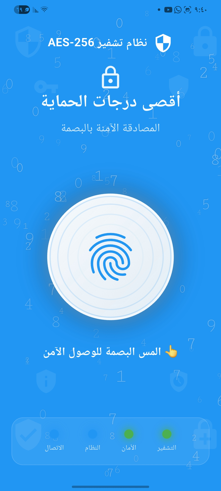
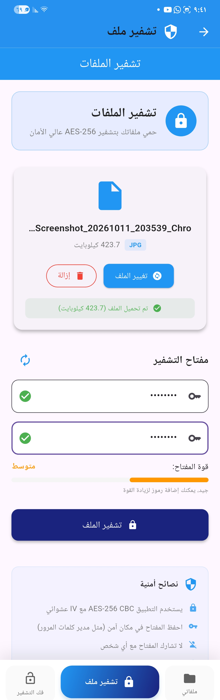
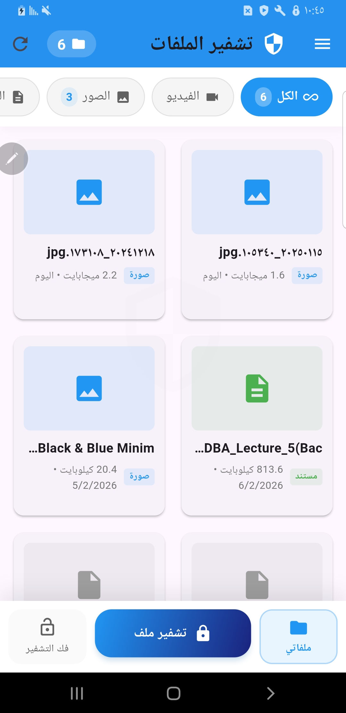
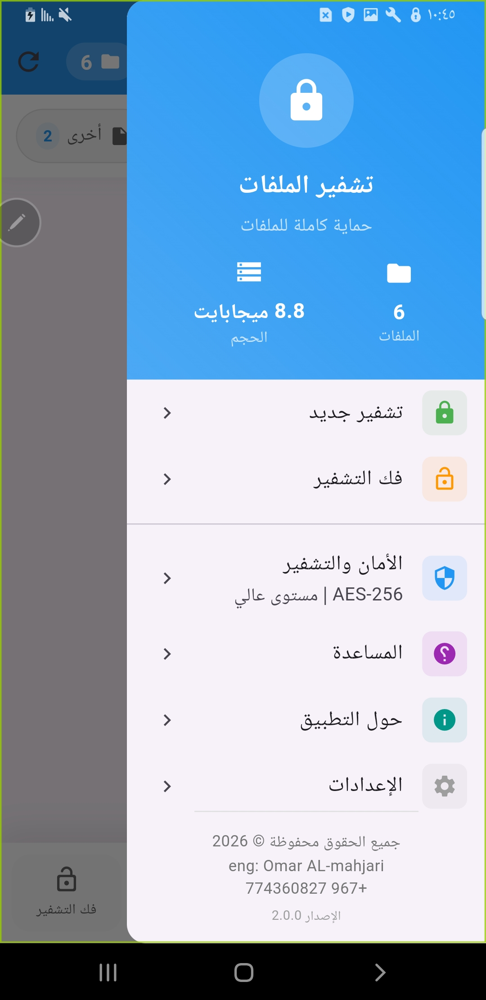

# تطبيق تشفير الملفات

  
  <h3>تطبيق لإدارة الملفات وحمايتها بالتشفير</h3>
  
مشروع ضمن ملف الأعمال.

## نبذة عن المشروع

تطبيق جوّال بواجهة عربية يساعد على تشفير الملفات وفك تشفيرها باستخدام مفتاح يحدده المستخدم. يوفّر اختيار الملفات، متابعة عملية التشفير، وتنظيم الملفات المشفّرة وإدارتها من داخل التطبيق، مع شاشة مصادقة حيوية قبل الوصول.

## أبرز المزايا

- تشفير الملفات وفك تشفيرها باستخدام AES.
- اختيار الملفات من الجهاز وحفظ الملفات الناتجة.
- استعراض الملفات المشفّرة وإدارتها ومشاركتها.
- مصادقة حيوية بالبصمة أو وسيلة المصادقة المتاحة على الجهاز.
- واجهة عربية تدعم اتجاه الكتابة من اليمين إلى اليسار.

## التقنيات المستخدمة

| التقنية | الاستخدام |
| --- | --- |
| Flutter | بناء واجهة التطبيق |
| Dart | منطق التطبيق |
| `encrypt` | عمليات تشفير الملفات وفك تشفيرها باستخدام AES |
| `local_auth` | المصادقة الحيوية |
| `file_selector` | اختيار الملفات |
| `share_plus` | مشاركة الملفات |
| `open_file` | فتح الملفات بعد فك التشفير |
| `permission_handler` | التعامل مع أذونات الجهاز |
| `path_provider` | الوصول إلى مسارات تخزين التطبيق |

## ملفات المشروع

يحتوي المستودع على الشيفرة المصدرية للتطبيق داخل `lib/`، واختبارات `test/`، وملفات تعريف الحزم والإعدادات مثل `pubspec.yaml` و`pubspec.lock`، إضافة إلى ملفات المنصات والأصول اللازمة لمراجعة المشروع. لا يتضمن المستودع ملفات البناء أو الكاش أو مفاتيح التوقيع أو بيانات الاعتماد السرية.

## لقطات من التطبيق

<h3>شاشة المصادقة بالبصمة</h3>
  
<h3>الواجهة الرئيسية للتطبيق</h3>
  
  <h3>قائمة الملفات المشفرة</h3>
  
  <h3>واجهة تشفير الملفات</h3>
  

## ملاحظة

هذا المشروع معروض ضمن ملف الأعمال، ويشمل المستودع الشيفرة المصدرية والملفات الأساسية لمراجعتها. ملفات البناء والاعتماديات المولّدة محلياً غير مضمّنة.
